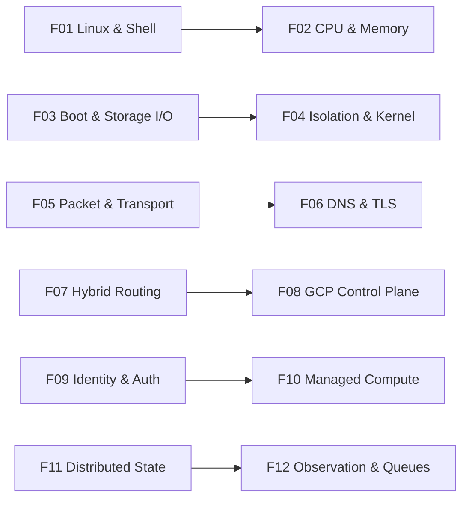
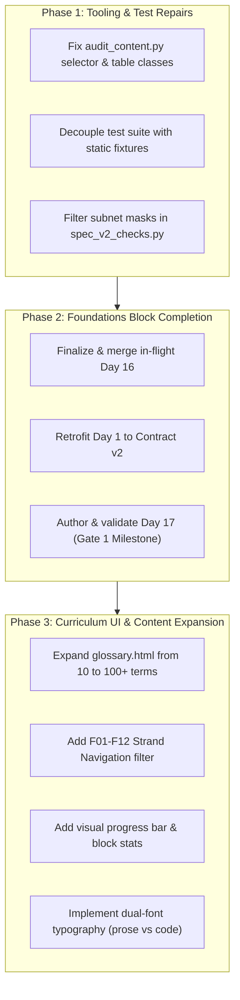

# GCP 180-Day Architect Site — Comprehensive Audit & Quality Analysis

> [!IMPORTANT]
> **Audit Status Summary:**
> - **Curriculum Structure:** Upstream roadmap is exceptionally well-conceived (11 work blocks, 6 gates, 5 capstones, 12 foundation strands, 4 progression tiers). However, the site UI currently exposes only the work blocks—ignoring the 12 foundation strands and progression levels.
> - **Content Coverage:** 520 mapped topics across 180 days covering all 83 source IDs. However, only 65 of 520 topics (12.5%) have verified publisher sections; 455 remain unverified.
> - **Content Quality Disparity:** A stark divide exists between authored days (Days 2–15: ~220KB avg, 25+ code blocks, 8+ SVGs, 8-stage executable labs) and template fallback days (54 days have **0 code blocks**, 14 days have **0 SVGs**, 173 days rely on tabletop worksheets).
> - **Auxiliary Content:** `glossary.html` is severely deficient (contains only 10 terms for a 180-day curriculum).
> - **Codebase & Tooling:** 12 unit tests fail due to test harness coupling; `audit_content.py` crashes on Days 9 and 10; IPv4 check produces false positives on subnet masks.

---

## 1. Upstream Roadmap & Pedagogical Architecture Audit

The curriculum is derived from `../roadmap-180-days.md` (2,161 lines, 167KB) and `../gcp-architect-180-day-page-prompts.md` (4,696 lines, 439KB).

### 1.1 The 11 Work Blocks
The curriculum organizes 180 study days (estimated at 485.5–665 hours) into 11 distinct blocks:

| # | Work Block | Day Range | Days | Topics | Topics/Day | Est. Hours | Core Milestone |
|---|---|---|---:|---:|---:|---:|---|
| 1 | **Foundations** | Days 1–17 | 17 | 46 | 2.7 | 34–51 | **Gate 1 (Day 17)**: Local baseline, process/network paths, SQL & Linux |
| 2 | **Cloud environment and identity** | Days 18–35 | 18 | 44 | 2.4 | 36–54 | **Gate 2 (Day 35)**: Cloud sandbox, IAM, ADC, billing & quotas |
| 3 | **Core services and integrated practice** | Days 36–67 | 32 | 105 | 3.3 | 96–128 | **Gate 3 (Day 67)**: GCE, GKE, Cloud Run, VPC, Cloud SQL, Spanner |
| 4 | **Requirements, migration and architecture** | Days 68–82 | 15 | 49 | 3.3 | 37.5–52.5 | **Gate 4 (Day 82)**: WAF lenses, discovery, ADRs, wave migration |
| 5 | **Reliability and security** | Days 83–118 | 36 | 117 | 3.2 | 108–144 | **Gate 5 (Day 118)**: SRE, SLOs, incident response, Zero Trust, KMS/CMEK |
| 6 | **Performance, delivery and operations** | Days 119–133 | 15 | 41 | 2.7 | 45–60 | CI/CD, Terraform, Cloud Monitoring, Profiler, FinOps |
| 7 | **Data, AI and distributed correctness** | Days 134–145 | 12 | 32 | 2.7 | 36–48 | BigQuery, Dataflow, Pub/Sub, Vertex AI, vector search |
| 8 | **Discovery, cases and exam preparation** | Days 146–164 | 19 | 43 | 2.3 | 47.5–66.5 | Case studies (EHR, Mountkirk, TerramEarth), exam domains |
| 9 | **Multi-team architecture and synthesis** | Days 165–173 | 9 | 35 | 3.9 | 27–36 | Landing zones, cross-project networking, platform engineering |
| 10 | **Final gate and capstone defenses** | Days 174–179 | 6 | 7 | 1.2 | 18–24 | **Gate 6 (Day 174)** + **5 Capstone Defenses (Days 175–179)** |
| 11 | **Final review and rest** | Day 180 | 1 | 1 | 1.0 | 0.5–1 | Review, uncertainty log, exam logistics, continuing study |

---

### 1.2 The 12 Foundation Strands (F01–F12)
The roadmap defines 12 fundamental architectural mechanism strands that trace learner progression from introductory vocabulary to advanced multi-team governance:

| Strand | Mechanisms | Progressive Lifecycle Across Curriculum |
|---|---|---|
| **F01** | Linux execution & shell | Days 6–7 (Intro) → 15, 34, 41 (Guided/Diag) → 126–130 (Design/Gov) |
| **F02** | CPU & memory bounds | Day 8 (Intro) → 36, 41, 43–45 (Guided/Diag) → 124–125, 169 (Design/Gov) |
| **F03** | Filesystem & storage I/O | Days 6, 10 (Intro) → 37, 58–60, 91 (Guided/Diag) → 124, 172, 177 (Design/Gov) |
| **F04** | Kernel isolation & security | Day 9 (Intro) → 43–46, 115 (Guided/Diag) → 165, 170, 176 (Design/Gov) |
| **F05** | Packet paths & transport | Days 2–4 (Intro) → 49–54, 57 (Guided/Diag) → 88, 171 (Design/Gov) |
| **F06** | DNS, TLS & web protocols | Days 3–4 (Intro) → 52–54, 105 (Guided/Diag) → 167, 171 (Design/Gov) |
| **F07** | Network state & BGP | Days 4–5 (Intro) → 51, 56–57 (Guided/Diag) → 88, 165, 171 (Design/Gov) |
| **F08** | GCP control plane & APIs | Days 19–23, 34 (Intro) → 42, 126–127 (Guided/Diag) → 130–131, 165 (Design/Gov) |
| **F09** | Identity, tokens & IAM | Days 24–26 (Intro) → 35, 99–102, 142–143 (Guided/Diag) → 166, 176 (Design/Gov) |
| **F10** | Managed compute & GKE | Days 9–10 (Intro) → 36–48 (Guided/Diag) → 144, 165, 170 (Design/Gov) |
| **F11** | Distributed state & ACID | Days 13, 16 (Intro) → 59, 61–64, 76, 137 (Guided/Diag) → 145, 167, 178 (Design/Gov) |
| **F12** | Observability, SLO & queues | Days 13, 15, 85–86 (Intro) → 93–98, 123–125 (Guided/Diag) → 144, 169, 179 (Design/Gov) |

> [!WARNING]
> **Curriculum Gap Identified:** Although the roadmap explicitly anchors learning to these 12 strands, **the rendered site has zero strand navigation or indexing**. A learner cannot filter by strand F05 or view their progress across networking or state mechanics.

---

### 1.3 The 4-Tier Competency Progression
The curriculum enforces a 4-tier repetition model:
1. **Explain & Guided Practice:** Learn mechanism, observe expected baseline.
2. **Diagnose & Validate:** Inject faults, inspect telemetry, debug failure boundaries.
3. **Design from Evidence:** Author Architecture Decision Records (ADRs) backed by prior experiments.
4. **Govern & Defend:** Establish multi-team standards, exception policies, and capstone defenses.

---

### 1.4 The 6 Evaluation Gates & 5 Capstones

| Milestone | Day | Title | Required Output & Proof |
|---|---:|---|---|
| **Gate 1** | 17 | Foundations Recall & Repair | Request/process tracing, local service reproduction, corrected subnet & SQL math, cleanup audit. |
| **Gate 2** | 35 | Cloud Readiness | Active GCP identity, least-privilege IAM validation, API operation lifecycle, zero residual cost. |
| **Gate 3** | 67 | Core Operations | Multi-tier app reproduction, trace request/state/identity, fault injection recovery, idempotency invariant. |
| **Gate 4** | 82 | Architecture & Requirements | 3 ADRs traced to business requirements, migration rehearsal, corrected architecture trade-offs. |
| **Gate 5** | 118 | Reliability & Security | SRE recovery rehearsal, access perimeter enforcement, CMEK audit, incident analysis with telemetry. |
| **Gate 6** | 174 | Integrated Readiness | Full 83-topic audit, multi-team ownership matrix, draft defense packages for all 5 capstones. |
| **Capstone 1** | 175 | Landing Zone Defense | Organization hierarchy, SCPs, Shared VPC, automated tenant onboarding, break-glass runbook. |
| **Capstone 2** | 176 | Regulated Workload Defense | FedRAMP/HIPAA boundaries, VPC Service Controls, CMEK key rotation, audit log immutability. |
| **Capstone 3** | 177 | Global Application Defense | Multi-region active-active Spanner/Cloud Run, Cloud CDN/Anycast LB, simulated regional loss. |
| **Capstone 4** | 178 | Legacy Migration Defense | Database replication reconciliation, wave cutover rehearsal, zero-data-loss rollback path. |
| **Capstone 5** | 179 | Cost & Reliability Rescue | FinOps audit, reserved commitments/CUDs, auto-scaling tuning under strict SLO preservation. |

---

## 2. Content Coverage Audit

### 2.1 Topic Distribution & Catalog Mapping
- **Total Days:** 180
- **Total Topic Rows in `coverage.csv`:** 520 (Average: 2.89 topics/day)
- **Topic Range:**
  - 18 days have **1 topic** (Days 32, 66, 116, 117, 127, 132, 144, 145, 153, 160, 161, 172, 175–180).
  - 55 days have **2 topics**.
  - 53 days have **3 topics**.
  - 41 days have **4 topics**.
  - 13 days have **5 or 6 topics** (e.g. Day 4 has 5 topics; Days 45, 50, 56, 165 have 6 topics).

### 2.2 83 Source Topic Utilization
All 83 catalog topic IDs (from the 100-day source catalog) are represented:
- **Heavily Referenced Topics:**
  - Topic 13 (Cloud Storage / State): referenced in 23 day-rows
  - Topic 69 (Progress Tracker / Meta): referenced in 22 day-rows
  - Topic 16 (Compute Engine / VMs): referenced in 19 day-rows
  - Topic 14 (Networking / VPC): referenced in 17 day-rows
  - Topic 1 (TCP/IP & OSI Foundations): referenced in 15 day-rows
  - Topic 34 (Monitoring & Logging): referenced in 15 day-rows
- **Underrepresented Topics (referenced only once):**
  - Topic 59 (Cloud Spanner Advanced Schema Design)
  - Topic 60 (Database Migration Service)
  - Topic 64 (Anthos Config Management)

### 2.3 Citation & Publisher Verification Gap
- **Verified (`publisher_section_verified=yes`):** 65 topics (**12.5%**)
- **Unverified (`publisher_section_verified=no`):** 455 topics (**87.5%**)
The vast majority of days link to general publisher landing pages rather than verified deep sections or timestamped videos.

---

## 3. Content Quality Audit: Authored vs Template Realities

Analysis across all 180 rendered HTML pages reveals a massive quality disparity:

| Metric | Authored Days (Days 2–15) | Template Days (Sample: 30, 50, 70, 100, 175–180) | Total Curriculum Reality |
|---|---|---|---|
| **Average Page File Size** | **226,300 bytes** (Day 4: 325KB) | **38,400 bytes** (Days 175–180: ~26KB) | Min: 25.3KB / Max: 325.6KB / Avg: 110.7KB |
| **Code Blocks (`<pre>`)** | **28.4 per day** (Day 4: 45) | **1.2 per day** | **54 days have ZERO code blocks** |
| **SVG Architecture Diagrams** | **8.6 per day** (Day 7: 13) | **0.4 per day** | **14 days have ZERO diagrams** |
| **External Citations** | **31.2 per day** (exact fragments) | **2.8 per day** (generic URLs) | Avg: 5.1 per day |
| **Executable 8-Stage Labs** | **100% compliant** | **~25% partial, ~75% generic worksheet** | 71 days have 8-stage headers; 109 lack them |
| **Fictional Scenario Anchoring** | Concrete Brightloaf systems with failure domains | Inserted-title formulaic Brightloaf strings | 145 days cite Brightloaf (2,004 total mentions) |
| **Exercise Execution Mode** | Runnable CLI/curl/Python/SQL with exact cleanup | "Tabletop worksheet" (173 days mention tabletop) | 949 occurrences of "tabletop" |

### 3.1 Quality Failure Modes on Unauthored Days
1. **The "Input, Actor, Control Boundary" Boilerplate:** When the generator failed to match a keyword, it inserted identical generic paragraphs describing an "input, actor, control boundary" with no cloud-specific mechanics.
2. **The Tabletop Worksheet Loop:** 173 of 180 days describe tabletop exercises. Days 18–35 (Cloud Environment) and Days 36–67 (Core Services) claim "no cloud resources needed", leaving learners without actual `gcloud`, Console, or Terraform execution.
3. **Capstone Vacuum (Days 175–179):** The culminating capstone days are supposed to be extensive, rigorous defense packages. Currently, they are **26KB skeleton pages with 0 code blocks, 0 diagrams, and 0 interactive defense criteria**.

---

## 4. Auxiliary Pages Audit

| Page | Size | Content Count | Quality Assessment |
|---|---:|---:|---|
| **`glossary.html`** | 2,259 B | **10 terms** | **CRITICAL DEFICIENCY:** For a 180-day enterprise architecture course, defining only 10 terms (ADC, ADR, CIDR, IAM, RPO, RTO, SLI, SLO, TTL, WAL) is completely inadequate. Missing: VPC, GKE, PSC, CMEK, CNI, MTU, BGP, OIDC, SAML, WAF, SRE, etc. |
| **`sources.html`** | 48,907 B | 240 sections, 247 links | Comprehensive catalog from 100-day roadmap, but deep section links and access dates are missing for >85% of references. |
| **`artifacts.html`** | 33,666 B | 180 exit deliverables | Well-structured index linking each day to its required artifact; accurate roadmap reflection. |

---

## 5. Codebase & Tooling Bugs

### 5.1 Bug 1: `audit_content.py` RuntimeError
- **File:** [scripts/audit_content.py](file:///home/naveen/GitRepos/Projects/GCP/RoadMap/gcp-180day-architect-site/scripts/audit_content.py#L44-L46)
- **Cause:** In [scratch/day_data_009.py](file:///home/naveen/GitRepos/Projects/GCP/RoadMap/gcp-180day-architect-site/scratch/day_data_009.py#L875) and [scratch/day_data_010.py](file:///home/naveen/GitRepos/Projects/GCP/RoadMap/gcp-180day-architect-site/scratch/day_data_010.py#L988), HTML tables are wrapped in `
`.
- **Impact:** Selector `#part-{part} .topic-card` counts nested cards, causing a card mismatch exception that halts the content audit script.

### 5.2 Bug 2: 12 Unit Test Failures
- **Files:** [tests/test_validate_spec.py](file:///home/naveen/GitRepos/Projects/GCP/RoadMap/gcp-180day-architect-site/tests/test_validate_spec.py) and [tests/test_batch_safety.py](file:///home/naveen/GitRepos/Projects/GCP/RoadMap/gcp-180day-architect-site/tests/test_batch_safety.py)
- **Cause:** Tests load active day specs (`day_data_002.py`, `day_data_003.py`, `day_data_004.py`) that were updated to Contract v2, rather than static mock fixtures.

### 5.3 Bug 3: Subnet Mask & CGNAT False Warnings
- **File:** [scripts/spec_v2_checks.py](file:///home/naveen/GitRepos/Projects/GCP/RoadMap/gcp-180day-architect-site/scripts/spec_v2_checks.py#L90-L95)
- **Cause:** Regex flags dotted-quad subnet masks (`255.255.255.0`, `255.240.0.0`) and RFC 6598 CGNAT (`100.64.0.0/10`) as illegal public IP literals.

---

## 6. Strategic Recommendations

1. **Immediate Tooling Fixes:** Patch `audit_content.py`, create static test fixtures in `tests/fixtures/` to fix the 12 failing tests, and update netmask validation in `spec_v2_checks.py`.
2. **Foundations Gate Milestone:** Complete Day 16 review/merge, retrofit Day 1 to Contract v2, and author Day 17 (Foundations Gate) to formally complete the entire first block (Days 1–17).
3. **Glossary Expansion:** Expand `glossary.html` from 10 terms to a comprehensive 100+ term architectural reference.
4. **Strand & Progression Navigation:** Expose the 12 Foundation Strands (F01–F12) and 4 Competency Levels in the site UI so learners can filter and navigate by architectural mechanism across all 180 days.
